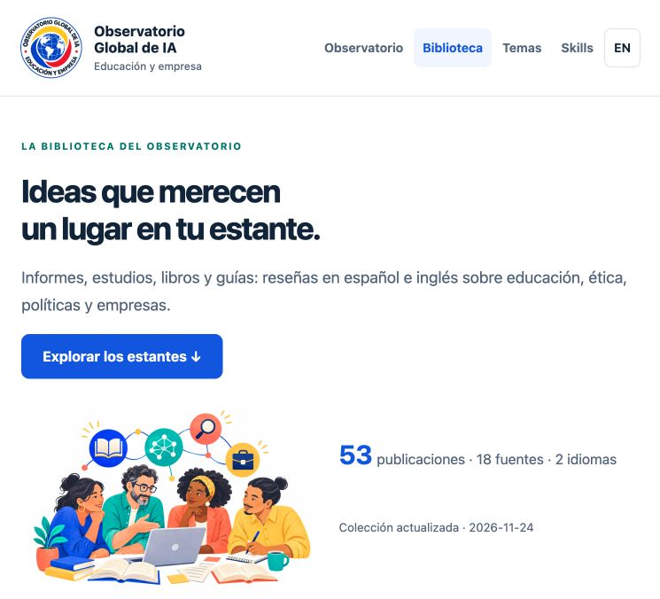

# Candidato institucional del Observatorio — 24 noviembre 2026

Estado: preparado localmente; sin publicación remota. Vista previa: http://127.0.0.1:4184/biblioteca/.

## Selección vigente

Biblioteca: **53 publicaciones** de 18 instituciones/editoriales institucionales. Se conservan las 30 fichas originales, seis de la primera ampliación y 17 altas de Downloads: nueve educativas, dos de empresa, una guía universitaria y cinco de gobernanza/contexto.

Se retiraron 23 de las 76 fichas del candidato anterior conforme al criterio del responsable: material de editoriales comerciales, consultoras, empresas, guías de productos y casos de afiliación académica/corporativa mixta. Los registros y notas de consumo interno permanecen fuera del repositorio publicable. Los PDFs de Downloads no se movieron ni eliminaron.

Skills conserva cuatro fichas: Universidad de Helsinki y tres cursos gratuitos de Google autorizados expresamente por el usuario. De las13retiradas iniciales, tres se restituyen y diez permanecen internas. Las rutas y filtros se adaptan a los recursos disponibles, sin páginas vacías ni enlaces a cursos retirados.

El directorio contiene **35 recursos** y se centra en fuentes institucionales. La referencia del centro público TII se orienta a la institución y su investigación. La referencia del foro público-privado queda en reserva interna. Las incorporaciones institucionales de esta sesión incluyen Obvia, IFE, JRC Scientific AI Hub, Stanford AI Index, MIT AI Risk Initiative e INTEF; no representan convenios ni alianzas.

## Política y alcance

La [política editorial](../../EDITORIAL_POLICY.md) recoge la instrucción del usuario. Se publican reseñas propias y enlaces originales, sin alojar PDFs ni portadas ajenas. Ser una fuente pública o universitaria no certifica por sí solo una licencia de redistribución. Las referencias incidentales a tecnologías dentro de estudios institucionales no son publicaciones comerciales del proveedor.

Los JSON por lote contienen exclusivamente altas vigentes. Los expedientes de investigación completos, inventarios de Downloads, estudios reservados y referencias comerciales están archivados localmente fuera del repositorio. No se han enviado a terceros ni incorporado a entrenamientos.

## Verificación y entrega

154 pruebas correctas, cero fallos y una omisión por archivo bruto ausente; 53 fichas sin problemas editoriales. Sitemap de 134 URLs y ningún destino interno faltante. Resultados del candidato depurado en [validation.json](validation.json). Se comprueba ausencia de fichas retiradas, navegación ES/EN, rutas Skills disponibles y consistencia del sitemap. Las estadísticas conservan el corte de 10 noviembre 2026, sin importar nuevos rankings.

Rama update/observatorio-2026-11-24 en copia aislada. Sin commit, push, PR, merge ni despliegue de esta selección.

