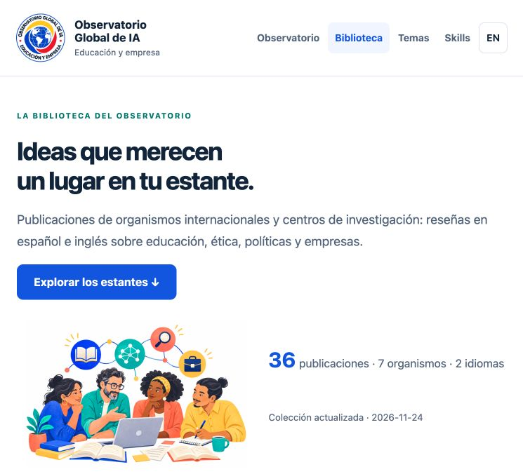

# Actualización editorial del Observatorio — 24 de noviembre de 2026

**Nota de continuidad:** versión inicial sustituida por [el candidato institucional vigente](../downloads-2026-11-24/CANDIDATO.md). Las cifras siguientes describen únicamente la primera etapa.

Estado: candidato local revisable; no publicado. Vista previa: http://127.0.0.1:4184/biblioteca/ y http://127.0.0.1:4184/#official-directory.

## Resultado

- Biblioteca: 30 → 36 publicaciones, con seis fichas nuevas en español e inglés. Las 30 fichas anteriores conservan contenido y fechas individuales.
- Directorio: 30 → 34 recursos. Altas: Obvia, Observatorio IFE, JRC Scientific AI Hub y Stanford AI Index. Hub y Stanford se clasifican como investigación.
- Correcciones: AI Watch identificado como archivo histórico (proyecto 2018–2022; datos de paneles sin actualizar desde 2020); referencia ILIA actualizada a la edición 2026 en directorio y tabla comparativa.
- Fechas de publicación y anuncio visibles independientemente de que exista enlace documental. Los registros UNESCO enlazan al documento oficial sin prometer descarga PDF.
- Se conserva la distinción entre fecha de actualización de la colección/directorio y revisión individual. El directorio explicita que un enlace no representa alianza institucional.
- Biblioteca genera 12 páginas nuevas; total del sitemap candidato: 122 URLs. Esto no demuestra indexación en buscadores.

## Las seis incorporaciones

| Publicación | Fecha | Utilidad |
|---|---|---|
| OCDE, Digital Economy and Society Outlook 2026 | Publicación 5 nov 2026 | Adopción empresarial, capacidades y brechas |
| Banco Mundial, World Development Report 2026: The Promise of Artificial Intelligence | Documento/lanzamiento 4 ago; divulgación del registro 4 sep 2026 | Adopción y adaptación de IA en países de ingreso bajo y mediano |
| CEPAL/CENIA, ILIA 2026 | Publicación 20 oct 2026 | Ecosistemas regionales y comparabilidad metodológica |
| OCDE/Comisión Europea, Empowering Learners for the Age of AI | Publicación 18 jun 2026 | Alfabetización en IA para primaria y secundaria |
| UNESCO, AI Answers. You Decide | Anuncio 10 nov 2026; año documental 2026 | Alfabetización mediática, información y pensamiento crítico |
| UNESCO/UCL, Can We Trust AI on Climate? | Anuncio 16 nov, actualizado 18 nov 2026 | Evaluación crítica de respuestas y diferencias entre lenguas |

Fechas de anuncio no se sustituyen por fechas exactas de publicación. Las seis reseñas declaran revisión de ficha/resumen/comunicado oficial, no lectura íntegra. ILIA fue contrastado con información oficial indexada; su apertura directa devolvió 403. Las fuentes y límites específicos están en [publications-research.md](publications-research.md).

## Fuentes y posibles colaboraciones

La [matriz de observatorios](observatories-research.md) distingue enlaces, posibles integraciones y vías públicas de colaboración. Prioridad: IFE para utilidad docente en español; Scientific AI Hub para evidencia europea; Obvia para investigación social y cooperación; Stanford para perspectiva global. UNESCO ofrece una red de sociedad civil e instituciones académicas y OECD.AI publica una vía para colaboradores. No se verificó admisión, no se contactó a nadie y no existe acuerdo nuevo.

## Verificación

- Base de trabajo: main `9805bc63bad7fcb963733585e3e0bc1e6d973037`, obtenida del remoto. Rama local `update/observatorio-2026-11-24`.
- Publicación remota existente al inicio: ejecución Pages `45488723074`, success, correspondiente a actualización de titulares del 24 de noviembre.
- Dependencias instaladas desde caché con `npm ci --offline --ignore-scripts`; compilación completa correcta.
- `npm run check`: 153 pruebas aprobadas, 0 fallos y 1 omisión prevista por ausencia de archivos brutos `data/raw` en el checkout.
- Tras ajuste final de etiqueta del directorio: compilación y 20 pruebas focalizadas aprobadas, 0 fallos/omisiones.
- `npm run check:publication`: aprobada para revisión humana. Compara el snapshot conservado; no es una consulta nueva de las fuentes estadísticas.
- `git diff --check`: correcto.
- Navegador: búsqueda ILIA 2026, ficha UNESCO ES/EN con fecha de anuncio y enlace documental, filtro América + Datos y observatorios (Obvia/IFE visibles), biblioteca de 36 fichas y directorio de 34 recursos.
- Revisión independiente detectó dos etiquetas imprecisas (fecha global del directorio y enlace UNESCO denominado PDF), ambas corregidas.
- `snapshot.json`, baseline, `observations.json` y `dashboard/artifact.json` permanecen idénticos a la base. No se refrescaron series ni se importaron puntajes ILIA. El corte estadístico sigue siendo 10 nov 2026; 5.280 observaciones no se presentan como datos nuevos.

## Próximo paso

Revisión editorial del candidato por el responsable, seguida de publicación mediante PR, CI e integración cuando se autorice. No se realizaron commit, push, PR, merge, despliegue, solicitudes de indexación ni cambios de Search Console en esta sesión.

